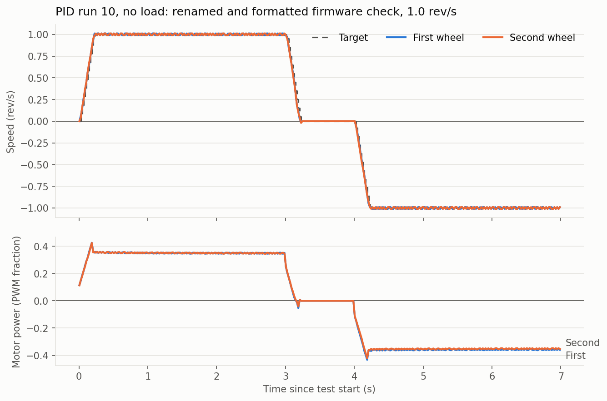

# Milestone 1: Drive it

Finished on the bench on 9 November 2026, with the wheels lifted and a 12 V bench supply limited to 1.5 A. On 19 November it drove on the floor in its finished chassis, on its own battery, with every safety stop working.

**Done when** ([build plan](build-plan.md)): each wheel holds a commanded speed, with the PID step response plotted, and the motors stop when commands stop.

| Check | Measured | Data |
| --- | --- | --- |
| Holds a commanded speed | Steady 1.000 rev/s (0.21 m/s) on both wheels at 0.349 power; peak 1.011, one encoder step above the target, so no real overshoot | [PID run 10](../results/pid/2026-11-09-run10-no-load-1.0rps-naming-and-format-check.png) |
| Follows the ramp | Within 0.035 rev/s during the 5 rev/s² ramp, settled when it ends, about 230 ms after the command | [PID run 07](../results/pid/2026-11-09-run07-no-load-1.0rps-aligned-timing.png) |
| Holds speed under load | With light finger pressure on both wheels, worst sample 3% slow, none beyond 4% | [PID run 08](../results/pid/2026-11-09-run08-fingers-on-1.0rps-aligned-timing.png) |
| Stops when commands stop | Stopping the bridge mid-drive stopped the wheels through the Pico's 250 ms command timeout (seen on the bench; the recording ends with the bridge) | [Teleop run 02](../results/teleop/2026-11-09-run02-no-load-keyboard-and-bridge-stop.png) |
| Driven from ROS | Keyboard teleop: both wheels followed forward, backward, turns and arcs, and 60 s of quick key switching | [Teleop runs 01–04](../results/README.md#teleop-teleop) |
| Drives on the floor | On the battery, driven over WiFi from the laptop with the bridge on the Pi: forward, back and turns; each bumper and the motor-power switch stopped it | Seen on 19 November, not recorded |
| Powers the Pi off on a flat battery | Bench supply in place of the battery, turned down: the motors stopped at 10.4 V, and at 10.0 V the bridge logged `Pico: SHUTDOWN: battery critically low. Powering off the Pi` and the Pi shut down | Seen on 23 November, bridge log |

## What was built

**Pico firmware** ([firmware/](../firmware/)), C++ on the Pico SDK:

- Encoders counted in hardware by PIO, and each motor driven by two 20 kHz PWM inputs on the MDD3A.
- A 50 Hz speed loop per wheel: feedforward from the measured motor model (kS, kV, kA), plus PI feedback with anti-windup, on a setpoint ramped at 5 rev/s².
- Safety stops that work without the Pi: the bumpers, a low-battery cutoff at 10.5 V, a stall check, a 250 ms command timeout and a 100 ms hardware watchdog. A stop holds until its cause is gone and a stop is commanded.
- Bench-test modes for the step test, the safety checks and motor identification, each logging CSV for the [tools/](../tools/) scripts.
- Host unit tests for everything that isn't hardware: the speed loop, safety, command parsing, test sequences and the drivetrain.

**ROS 2 bridge** ([ros/pico_bridge/](../ros/pico_bridge/)), run on the laptop for these tests and on the Pi since 10 November ([pi-setup.md](pi-setup.md)): turns `/cmd_vel` into wheel speeds for the Pico over USB serial, and publishes `/joint_states` and `/battery` from the Pico's 50 Hz status. It zeroes the command if `/cmd_vel` stops for 1 s.

**Chassis and power** ([cad/](../cad/)): two printed decks on standoffs, with the motors in printed mounts between them and the wheels at the centre, 180 mm apart. The battery feeds a 10 A fuse, then the 5 V converter for the Pi and, through a switch that cuts motor power only, the MDD3A. The Pico, encoder regulator, battery divider and I2C pull-ups are soldered on perfboard.

**Low-battery power-off:** at 10.2 V the Pico asks the Pi to shut down, and the bridge powers it off. The bridge starts at boot and restarts if the Pico reboots ([pi-setup.md](pi-setup.md#6-low-battery-power-off-and-starting-at-boot)).

**Motor model, measured rather than guessed** ([motor identification](../results/README.md#motor-identification-sysid)): open-loop power ramps and steps, fitted as in WPILib SysId, with the PI gains from IMC tuning. The two motors' kV and kA agree within 2% (kV 0.345 and 0.349, kA 0.0174 and 0.0171).

## What went wrong and what it taught

- **Overshoot that wasn't the gains.** Runs 04–06 overshot by 11–13% whatever the gains. The controller compared each speed reading, an average over the last 20 ms, with the setpoint for the end of the next 20 ms, so during ramps it pushed the wheels ahead. A simulation with the measured model reproduced the run; comparing like with like removed the overshoot (run 07).
- **Watchdog boot loop.** The Pico's first LED write takes about 0.5 s while the wireless chip finishes starting, longer than the 100 ms watchdog. It now happens before the watchdog starts.
- **Serial output blocking the loop.** With no one reading, USB serial waited up to 500 ms per line and would trip the watchdog. Output is now dropped instead.
- **Bench supply hiding the stall check.** Holding a wheel sagged the current-limited supply below the low-battery cutoff before the 0.5 s stall check could act. The stall check was confirmed by unplugging an encoder's ground instead; on the battery it will be the one that acts.
- **Teleop recordings that looked scrambled.** WSL's clock steps back 0.6–2.4 s about every 30 s, so recordings read in timestamp order interleave seconds. The data was always in order; the plotting script now reads it in file order. This only affects the laptop.
- **A shutdown request that would have misfired.** The Pico reads 0 V when no battery is plugged in, which is "critically low", so a Pi on its own supply would have powered itself off. Plugging a battery in or out also passes through the shutdown range for about a second, which is long enough to ask. And it asked only once, so a bridge that started late would never hear it. It now ignores readings under 6 V, asks only after 3 s in the range, and repeats the request until the Pi is gone.

## Not done yet

- **Step test under the robot's weight:** the recorded runs all had the wheels lifted. Floor driving showed no problems, but the step test hasn't been repeated on the floor.
