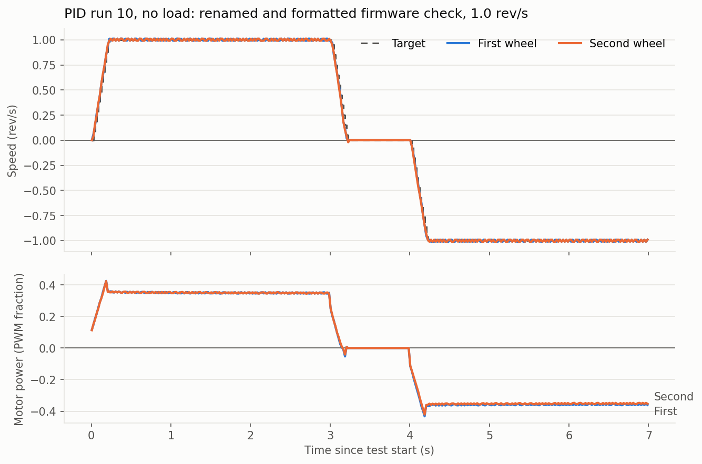

# Milestone 1: Drive it

Finished on the bench on 9 November 2026, with the wheels lifted and a 12 V bench supply limited to 1.5 A. Driving on the floor waits for the chassis and battery wiring.

**Done when** ([build plan](build-plan.md)): each wheel holds a commanded speed, with the PID step response plotted, and the motors stop when commands stop.

| Check | Measured | Data |
| --- | --- | --- |
| Holds a commanded speed | Steady 1.000 rev/s (0.21 m/s) on both wheels at 0.349 power; peak 1.011, one encoder step above the target, so no real overshoot | [PID run 10](../results/pid/2026-11-09-run10-no-load-1.0rps-naming-and-format-check.png) |
| Follows the ramp | Within 0.035 rev/s during the 5 rev/s² ramp, settled when it ends, about 230 ms after the command | [PID run 07](../results/pid/2026-11-09-run07-no-load-1.0rps-aligned-timing.png) |
| Holds speed under load | With light finger pressure on both wheels, worst sample 3% slow, none beyond 4% | [PID run 08](../results/pid/2026-11-09-run08-fingers-on-1.0rps-aligned-timing.png) |
| Stops when commands stop | Stopping the bridge mid-drive stopped the wheels through the Pico's 250 ms command timeout (seen on the bench; the recording ends with the bridge) | [Teleop run 02](../results/teleop/2026-11-09-run02-no-load-keyboard-and-bridge-stop.png) |
| Driven from ROS | Keyboard teleop: both wheels followed forward, backward, turns and arcs, and 60 s of quick key switching | [Teleop runs 01–04](../results/README.md#teleop-teleop) |

## What was built

**Pico firmware** ([firmware/](../firmware/)), C++ on the Pico SDK:

- Encoders counted in hardware by PIO, and each motor driven by two 20 kHz PWM inputs on the MDD3A.
- A 50 Hz speed loop per wheel: feedforward from the measured motor model (kS, kV, kA), plus PI feedback with anti-windup, on a setpoint ramped at 5 rev/s².
- Safety stops that work without the Pi: the bumpers, a low-battery cutoff at 10.5 V, a stall check, a 250 ms command timeout and a 100 ms hardware watchdog. A stop holds until its cause is gone and a stop is commanded.
- Bench-test modes for the step test, the safety checks and motor identification, each logging CSV for the [tools/](../tools/) scripts.
- Host unit tests for everything that isn't hardware: the speed loop, safety, command parsing, test sequences and the drivetrain.

**ROS 2 bridge** ([ros/pico_bridge/](../ros/pico_bridge/)), run on the laptop for these tests and on the Pi since 10 November ([pi-setup.md](pi-setup.md)): turns `/cmd_vel` into wheel speeds for the Pico over USB serial, and publishes `/joint_states` and `/battery` from the Pico's 50 Hz status. It zeroes the command if `/cmd_vel` stops for 1 s.

**Motor model, measured rather than guessed** ([motor identification](../results/README.md#motor-identification-sysid)): open-loop power ramps and steps, fitted as in WPILib SysId, with the PI gains from IMC tuning. The two motors' kV and kA agree within 2% (kV 0.345 and 0.349, kA 0.0174 and 0.0171).

## What went wrong and what it taught

- **Overshoot that wasn't the gains.** Runs 04–06 overshot by 11–13% whatever the gains. The controller compared each speed reading, an average over the last 20 ms, with the setpoint for the end of the next 20 ms, so during ramps it pushed the wheels ahead. A simulation with the measured model reproduced the run; comparing like with like removed the overshoot (run 07).
- **Watchdog boot loop.** The Pico's first LED write takes about 0.5 s while the wireless chip finishes starting, longer than the 100 ms watchdog. It now happens before the watchdog starts.
- **Serial output blocking the loop.** With no one reading, USB serial waited up to 500 ms per line and would trip the watchdog. Output is now dropped instead.
- **Bench supply hiding the stall check.** Holding a wheel sagged the current-limited supply below the low-battery cutoff before the 0.5 s stall check could act. The stall check was confirmed by unplugging an encoder's ground instead; on the battery it will be the one that acts.
- **Teleop recordings that looked scrambled.** WSL's clock steps back 0.6–2.4 s about every 30 s, so recordings read in timestamp order interleave seconds. The data was always in order; the plotting script now reads it in file order. This only affects the laptop.

## Not done yet

- **On the floor:** every run so far had the wheels lifted, on the bench supply. The next check is the same step test on the battery with the robot's weight on the wheels.
- **Pi shutdown on low battery:** the Pico sends `SHUTDOWN` at 10.2 V, but nothing on the Pi acts on it yet.
- **Milestone clip:** to record once it drives on the floor.
